# Enterprise Agentic RAG — Shared System and 17-Block Diagrams

This file contains the downloadable Mermaid source for the overall system and all 17 logical architecture blocks. It mirrors `docs/architecture/blocks/` and does not introduce a new implementation decision. The block documents remain authoritative.

Figma/FigJam board: [Enterprise Agentic RAG diagrams](https://www.figma.com/board/QqEFDcGE0GcP2TeMVqHxLd?utm_source=chatgpt&utm_content=edit_in_figjam&oai_id=v1%2FsD6TKv5BuUkJELwfaGR7gCeEO01MG6CaibfNs4OFbrP7dyudUEojv3&request_id=190e3671-6b81-4029-8f9b-725a9884993c&architecture=true)

## Overall system

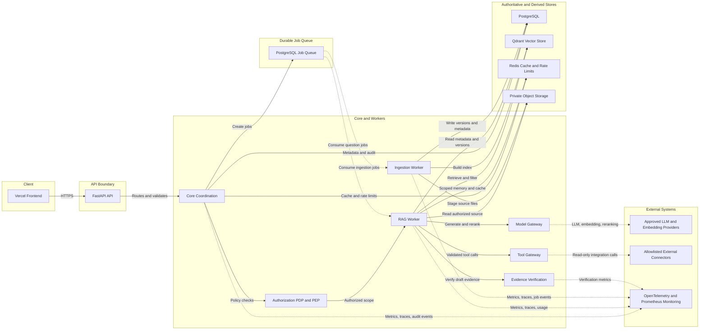

## 01 — Presentation Layer

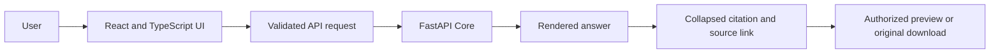

## 02 — API and Identity

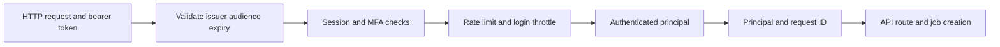

## 03 — Authorization

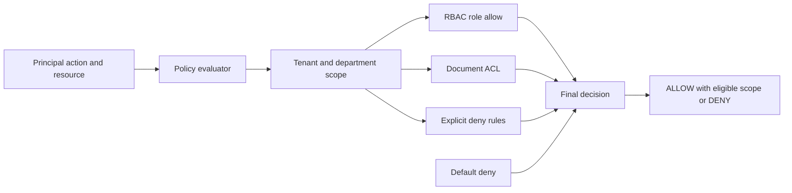

## 04 — Security and Guardrails

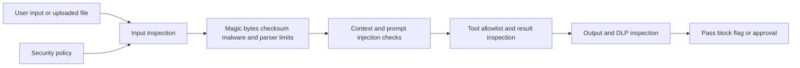

## 05 — Agent Orchestration

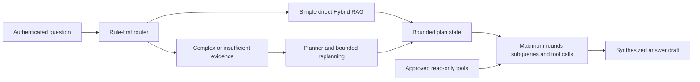

## 06 — Model Management

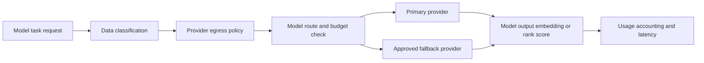

## 07 — Prompt Management

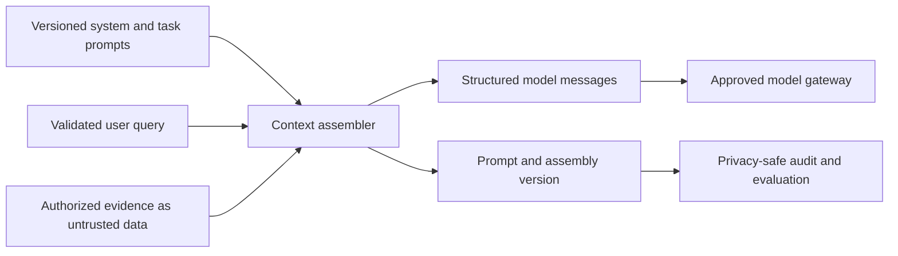

## 08 — RAG Engine

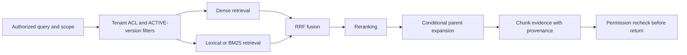

## 09 — Evidence Verification

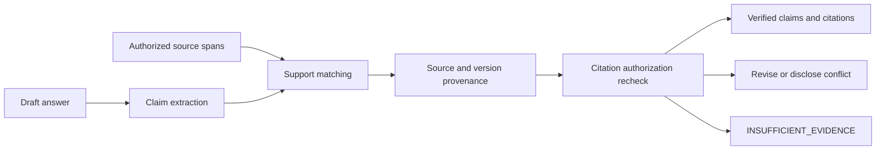

## 10 — Knowledge Management

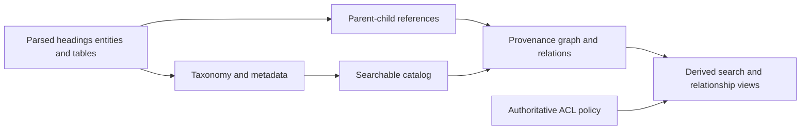

## 11 — Document Lifecycle

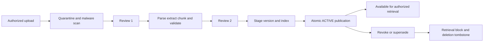

## 12 — Data Governance

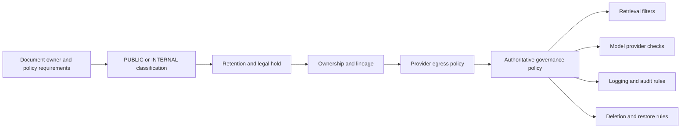

## 13 — Memory and Caching

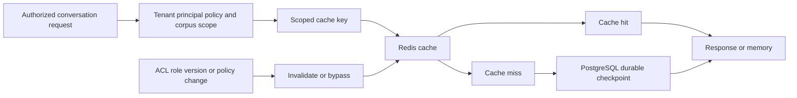

## 14 — Integration Layer

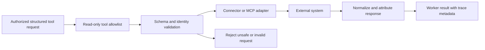

## 15 — Observability and Audit

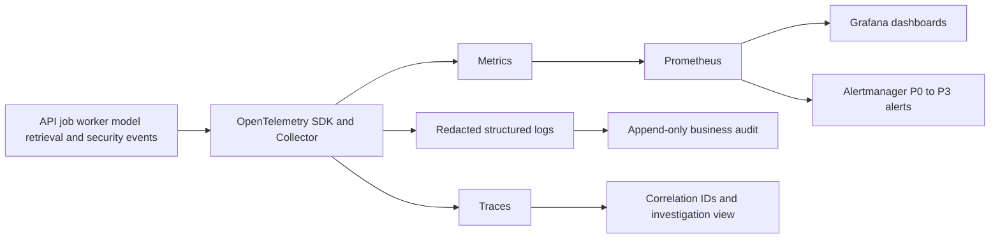

## 16 — Evaluation and Feedback

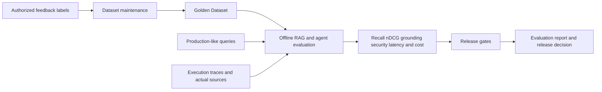

## 17 — Infrastructure and LLMOps

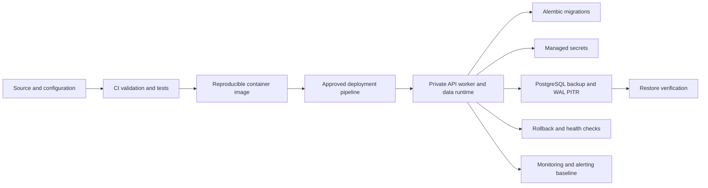
