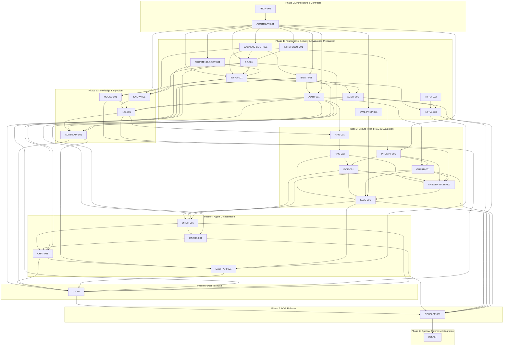

# Task Dependencies — Source: `tasks.json`

This diagram describes the dependency graph in `harness/tasks/tasks.json`. **Only `tasks.json` is the source of truth for task dependencies and statuses.** Update it first; keep this document synchronized. This file does not schedule agents automatically.

## Dependency Graph

An arrow `A → B` means **B depends on A**. All direct `depends_on` edges are shown below.

## Contract-First Parallel Work

- Shared contracts must be reviewed and **approved** before dependent integrations use them.
- Independent `READY` tasks may run in parallel with separate file ownership/worktrees. Local mocks may support contract-based testing but do not prove real integration.
- An implementation may reach `READY_FOR_INTEGRATION`; it becomes `DONE` only after required acceptance checks and real integration evidence are reviewed.
- A downstream task is not `READY` until every listed dependency is `DONE`. The current JSON schema lists task IDs only; it does **not** define a `contract_only` exception.
- When blocked, the agent reports the blocking task IDs, reason, and a handoff using `harness/handoffs/TEMPLATE.md`; the Main Agent may assign other independent `READY` work.

## Coordination and Approval

- The Main Agent coordinates task assignments and reviews evidence; `tasks.json` is updated only after review.
- Passing a phase gate does **not** authorize the next phase automatically; explicit Project Owner approval is required.
- `RELEASE-001` is the Phase 6 **MVP release review**. `INT-001` is Phase 7 **optional integration**, and must not block MVP release.
- Keep contract approval, security review, and Git approvals consistent with `AGENTS.md`, `PLANS.md`, and `docs/contracts/CHANGE-PROCESS.md`.
